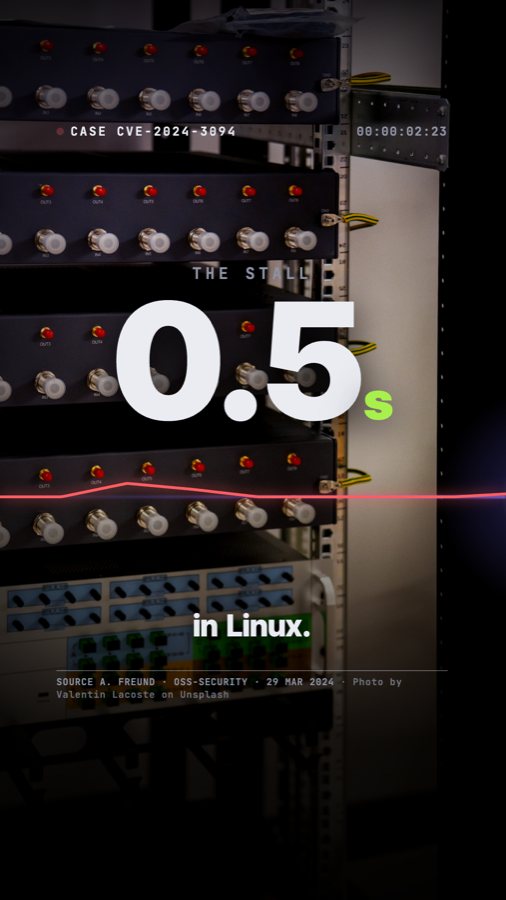
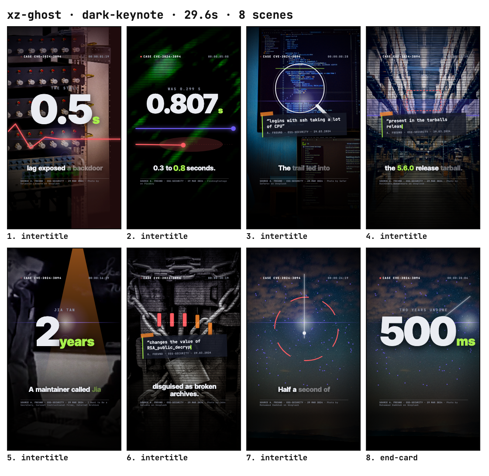
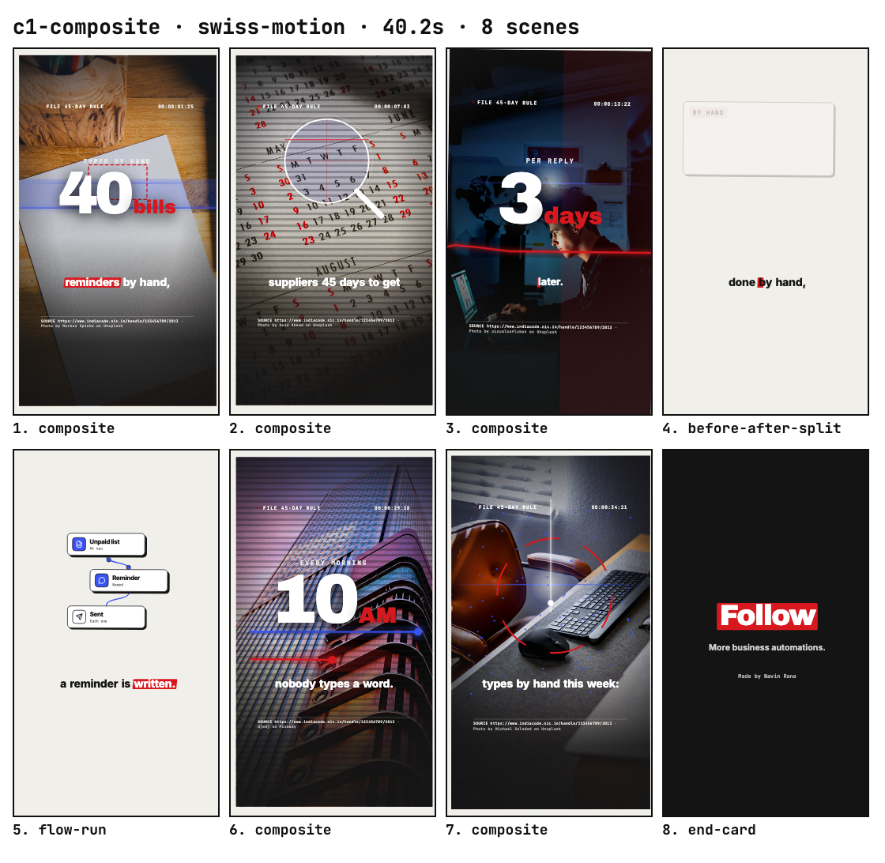
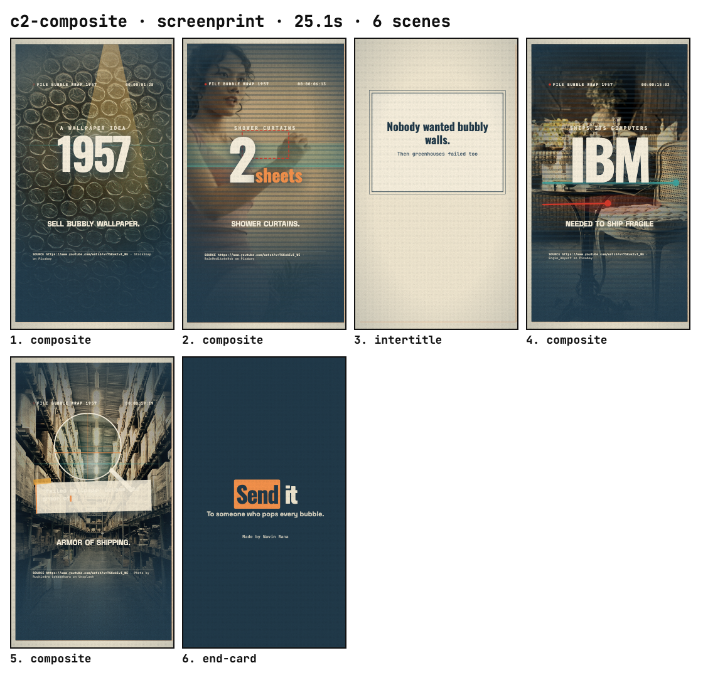
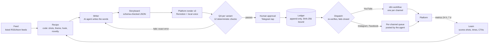

<div align="center">

# ⚡ FORGE Content Studio

**Evidence Films: documentary shorts built from sourced numbers, verbatim quotes and real photographic plates, composited in code.**<br/>
No video model, no paid voice API. Plates come from Unsplash, Pixabay and the Internet Archive with credits on screen; Remotion composites them; a local voice speaks; free code gates check it; a human approves it.

[](LICENSE)
[](https://www.remotion.dev)
[](https://www.typescriptlang.org/)
[](https://nodejs.org)
[](https://github.com/hexgrad/kokoro)
[](https://n8n.io)
<br/>
[](engine/src/composer/density.ts)
[](engine/src/host/power.ts)
[](engine/src/lib/score.ts)
[](engine/styles/README.md)

[Feature presentation](#-feature-presentation) · [Format styles](#-format-styles-and-primitives) · [4 gates](#-the-4-gate-architecture) · [Quickstart](#-quickstart)

</div>

---

### 🆕 Changelog

| Date | What landed |
|---|---|
| 2026-10-27 | **Art gate**: channel videos are built on composites. Text-in-box shots are rejected, a scene shows at most 12 words, and at least 40% of scenes sit on a real photo or clip plate. Recipes, the Writer and the router follow it for C1 and C2 |
| 2026-10-27 | **Cinematic composites**: real plates from Unsplash, Pixabay and the Internet Archive (`mediaHub`, cached and credited), four-layer documentary shots (`CinematicComposite`), and a topic router that never repeats a look. Flagship: *The 500 ms SSH Ghost* |
| 2026-10-26 | **29 format styles**: each a visual world, not a palette: its own camera (3D tilt, whip pan, kinetic punch, hand-held), texture (CRT, print, film on twos, tactical HUD), host behaviour, faces and pace. `--style=<id>` on any board |
| 2026-10-26 | **Visual-mode primitives**: an 8-bit status screen, a scanned point cloud, a live hand-drawn line and a silent-film intertitle, beside the inbox, sheet and chat shots |
| 2026-10-26 | **Contact sheet before render**: `npm run sheet` freezes every scene on one PNG with `remotion still`, under a second once bundled, before any voice or MP4 |
| 2026-10-26 | **Director cost guard**: dollar, call and minute ceilings; a failing line is repaired by a micro-call, never a restart |
| 2026-10-26 | **2.5 s density gate**: a board fails before render if 2.5 s pass with nothing new on screen |
| 2026-10-26 | **Power-word captions**: a marked word springs to 1.2x the moment Kokoro says it, timed to the exact word |
| 2026-10-26 | **Channel sound identity**: a music bed ducked 10 dB under the voice and a 2 s sonic bumper per channel |

---

## 🎬 Feature presentation

<table><tr>
<td width="360" valign="top">

<a href="docs/media/xz-ghost.mp4"></a>

<!-- drop docs/media/xz-ghost.mp4 here in the GitHub editor for an inline player -->

</td>
<td valign="top">

**The 500 ms SSH Ghost** (CVE-2024-3094): how half a second of login lag exposed the xz-utils backdoor. [Watch the film](docs/media/xz-ghost.mp4) (38 s, voiced).

- **Sourced:** every number and quote is from Andres Freund's [oss-security advisory](https://www.openwall.com/lists/oss-security/2024/03/29/4) of 29 March 2024: logins went from 0.299 s to 0.807 s.
- **Plates:** Unsplash and Pixabay photos and clips plus a 1941 public-domain film from the Internet Archive, fetched and cached by `engine/src/lib/mediaHub.ts`, credited in the citation bar.
- **Composite:** each shot is four layers (`engine/src/composer/CinematicComposite.tsx`): graded plate on a camera rig, light and texture, one hero number or verbatim quote, broadcast chrome with power-word captions.
- **Look:** chosen by `studio/router.ts` from the topic (security, so `dark-keynote`); the next video never shares its camera, texture, face or palette.
- **Sound:** local Kokoro voice, music bed ducked 10 dB under every line, 2 s sonic bumper, mastered to -14 LUFS.
- **Checks:** 235 frames measured, 0 text outside the platform safe areas. Board: [`engine/test/showcase/xz-ghost.json`](engine/test/showcase/xz-ghost.json).

</td>
</tr></table>

<p align="center"></p>

### Channel films

The two live channels run on the same composite format: a real photo plate, one hero number or quote, a citation bar.

<table><tr>
<th>C1 Automation · <code>swiss-motion</code></th><th>C2 Reach · <code>screenprint</code></th>
</tr><tr>
<td></td>
<td></td>
</tr></table>

---

## 🎨 Format styles and primitives

A format style is a whole visual world: palette, faces, spring, caption case, **camera** (`3d-tilt`, `whip-pan`, `kinetic-punch`, `handheld-doc`), **texture** (`crt`, `print`, `film`, `tactical`), **host** (keep, tint into the palette, or hide) and **pace**. The same board, timing and gates come out as a different film. Preview any style with `npm run sheet -- <board>.json --style=<id>`.

29 styles in all, from Swiss grid to woodcut, paper-cut, countdown, ops board, telestrator and sixties titles. The full table with every style's camera, overlay, host and faces is in [engine/styles/README.md](engine/styles/README.md). Authored films rotate across a separate catalogue of 267 format x look x colour combinations ([studio/looks.json](studio/looks.json)), so a feed does not repeat itself.

### Built-in primitives

Code-drawn shots that every style re-skins. No footage, no screenshots: each is a React component reading role tokens.

| Primitive | What it shows |
|---|---|
| `ui-inbox` | An inbox filling up or being triaged |
| `ui-sheet` | A spreadsheet whose rows update, flag and fill |
| `ui-chat` | A chat thread, typed and sent |
| `ui-diff` | A before/after code or text diff |
| `flow-build`, `flow-run` | An automation flow built node by node, then run |
| `counter-drop` | A sourced number landing |
| `before-after-split` | The manual way against the automated way |
| `rpg-panel` | An 8-bit status screen: stepped stat bars, then a typed dialogue box |
| `point-cloud` | A rotating scanned point cloud; a reticle locks and reads out a value |
| `line-draw` | One hand-drawn line travels stop to stop, circling and writing each label |
| `intertitle` | A silent-film title card: iris in, ruled frame, line, flourish |
| `split-flap`, `highlighter-swipe`, `stamp-hit`, `zoom-dive`, `pile-drop`, `word-stack-slam` and more | Reveals, emphasis and kinetic type (`engine/src/primitives/`) |

### Contact sheet before the render

```bash
cd engine
npm run sheet -- test/style-showcase.json --style=newsreel
# test/out/sheets/style-showcase.newsreel.sheet.png  9 scenes, still 0.7s after bundling
```

Every scene's middle frame on one PNG (hook first, payoff last), rendered with Remotion's `renderStill` from the real Composer, so layout, colour and text fit can be judged before voice or MP4. Bundling is extra: 2 to 5 s in total on an M-series Mac with a warm cache.


---

## 🧠 The 4-gate architecture

Every gate is plain code: free to run, same answer every time, and each one stops the pipeline with an exact reason.

| Gate | Checks | Where |
|---|---|---|
| **1. Script gate** | Hook rules, 15-word sentences and a 10-word average, banned openers and filler words, a re-hook at least every 45 words (and no run over 18 s on measured clips), one sourced proof per video | `studio/script.ts` |
| **2. Visual density gate** | No gap over 2.5 s with nothing new on screen (shot switch, cue, row, cursor, layout); checked before voicing and again on measured clips | `engine/src/composer/density.ts` |
| **3. Audio and bumper mixer** | Channel music bed ducked 10 dB under every voice line, faded before the end; 2 s sonic bumper after the last line; the closing scene is stretched to hold it | `engine/src/lib/score.ts`, `engine/src/films/kit.tsx` |
| **Art gate** | No text-in-box shots (inbox, sheet, chat, diff), at most 12 on-screen words per scene, 40% of scenes on photo or clip plates | `engine/src/composer/artgate.ts` |
| **4. Remotion renderer and QA** | WCAG AA theme contrast, text boxes measured in the real browser render, then 12 checks per platform file (schema, text limits, audio, format, duration, captions, fingerprint, manifest, CTA, SEO) | `engine/scripts/theme-gate.ts`, `engine/src/composer/textcheck.ts`, `studio/qa.ts` |

After the gates, nothing is published until the owner taps Approve on Telegram; the approval is bound to the video's SHA-256.

---

## ⚡ Quickstart

**Requirements:** macOS 14+, Node 26. For the voice: Python 3.12 with uv and espeak-ng. For publishing: Docker Desktop (n8n). Rendering and `npm run check` need neither Python nor Docker. Full guide: [docs/INSTALL.md](docs/INSTALL.md).

```bash
git clone https://github.com/navin-labs/forge-content-studio.git
cd forge-content-studio/engine
npm ci

# types, theme contrast, text QA, schemas and every test suite (no secrets, no network publishing, no model calls)
npm run check

# contact sheet in a format style (seconds), then a full render
# (silent unless VOICE=on in engine/.env)
npm run sheet -- test/style-showcase.json --style=terminal-dark
npm run make -- test/demo.json --style=newsreel
```

With the local voice installed ([INSTALL section 4](docs/INSTALL.md#4-voice-local-one-time)), set `VOICE=on` in `engine/.env` and the same command speaks.

Full cycle with fake Telegram and n8n (nothing is posted): `node studio/simulate.ts` from the repo root. Production setup (channels, n8n, Telegram, the agent, launchd services): [docs/INSTALL.md](docs/INSTALL.md), then [docs/SETUP.md](docs/SETUP.md).

---

## How FORGE works

FORGE runs autonomous short-video channels on YouTube, Instagram, and Facebook from your Mac. Each week it plans the videos in code, has an AI agent write the words, renders one video per platform with a React motion engine and a local voice, checks every file with deterministic QA, and sends each passing video to you on Telegram. Nothing is published until you tap Approve, and dispatch re-verifies everything right before sending.

### Automated vs. Human-Controlled

| Automated | Human-controlled |
|---|---|
| Topic intake from listed feeds, weekly planning, novelty rules | Approving each video (one Telegram tap per video, or "Approve all" for videos already shown) |
| Writing the storyboard (AI) and fixing it until QA passes | Taking an approval back before it goes out (`node studio/ledger.ts reject <id>`) |
| Rendering three platform variants, voice, captions, thumbnails | Turning a channel live, and turning dispatch live (two separate switches) |
| QA, routing, dispatch, retries, publish confirmation, metrics intake | Resolving an upload whose result is unknown (the system never retries it blind) |
| Small, logged tuning (posting times, benched shots) from metrics | Any larger change Learn proposes (applied only on a tap) |

**Live since 4 October 2026** on two channels, posting every other day ([docs/proof/live.txt](docs/proof/live.txt)). The render watcher is paused while the Director's cost guards are built.

---

## Architecture: The FORGE Pipeline



**Key principles:**
- **The Mac is the source of truth.** State is JSON and JSONL files in the repo's `state/`; n8n is a relay that holds platform credentials and asks the Mac before every upload.
- **Code decides, AI writes.** Planning, QA, approval, routing and learning are plain TypeScript. The AI agent fills in words and runs fixed posting skills.
- **One render per platform.** Each video becomes three independent files with their own call to action, end card, caption and approval line.

---

---

## Tech stack

- **Engine and renderer:** Remotion with TypeScript on Node 26 (`engine/`, render scripts `make.mjs` and `film.mjs`). No FFmpeg install is needed.
- **Primitives and composer:** deterministic Remotion shot primitives (inbox, sheet, chat, diff, flow, counter and more), a Composer that sequences them, host karaoke captions, and `Score`, which ducks each channel's synthesised music bed 10 dB under the voice and closes with a 2 s sonic bumper.
- **Voice and timing:** local Python text-to-speech with [Kokoro](https://github.com/hexgrad/kokoro) (82M parameters, no paid voice API). Its exact per-word times drive captions and word-timed cards. There is no speech-to-text step.
- **Quality gates (free, no model call):** `studio/script.ts` (hook, readability, re-hook, sourced proof), `engine/src/composer/density.ts` (no 2.5 s gap with nothing new on screen), theme contrast, text-box QA, and JSON Schema contracts checked by an in-repo validator.
- **Orchestration:** the studio is TypeScript with no build step (`studio/`); n8n runs in Docker and relays YouTube uploads, stats and feeds, asking the Mac before every upload.
- **Human approval:** signed Telegram approvals, a SHA-256-bound append-only ledger, and fail-closed dispatch.
- **Format styles:** `engine/styles/<id>.json` (theme, faces, spring, caption case, camera, overlay, host, pace). Faces and caption case are CSS variables, the camera moves the shot layer only, and the overlay sits outside the measured text, so no primitive changes per style.
- **State:** JSON and JSONL files in the repo. No database is required.

---

## The FORGE Pipeline: Detailed

1. **Feed** (`studio/feed.ts`): Fetches only feeds listed in `channel.json`, parses RSS/Atom, validates each idea, dedupes per channel.
2. **Recipe** (`studio/recipe.ts`, `studio/novelty.ts`): Code picks each posting day's shot list, theme, transitions and hook pattern.
3. **Writer** (AI agent, `agents/writer/FORGE_WEEKLY_WRITER.md`): Writes storyboard from top ideas, within measured text limits, passes the engine `--check` gate: the script gate (`studio/script.ts`: hook, 15-word sentences, 10-word average, banned filler, a re-hook at least every ~45 words, one sourced proof) and the visual-density gate (`engine/src/composer/density.ts`: no 2.5 s with nothing new on screen).
4. **Director** (AI agent, `agents/director/DIRECTOR.md`): Creates authored film with creative brief, Critic judges on 15 scores and 8 anti-slop tests.
5. **Render** (`engine/`): Renders each saved board once per platform with local voice measured line by line, then re-checks the re-hook and density gates on the measured clips. Channel boards also get the channel's music bed (ducked under the voice) and 2 s sonic bumper.
6. **QA** (`studio/qa.ts`): 12 checks per variant (schema, text limits, audio, format, duration, captions, fingerprint, manifest, CTA, SEO).
7. **Approval** (`studio/telegram.ts`, `studio/ledger.ts`): Each passing video reaches Telegram; tap writes ledger line with hash.
8. **Dispatch** (`studio/dispatch.ts`): Plans, re-verifies, and sends; YouTube as scheduled upload, Instagram/Facebook as queue items.
9. **Publish & Learn** (`studio/metrics.ts`, `studio/learn.ts`): Accept metrics only for dispatched posts; Learn benches weak shots and tunes posting times.

---

## Platform Variants

| Platform | CTA | Route | End Card |
|----------|-----|-------|----------|
| YouTube | Subscribe | Channel's n8n workflow, private scheduled upload | YouTube handle |
| Instagram | Follow or DM | `queue/<channel>/instagram/`, posted by agent | Instagram handle |
| Facebook | Follow | `queue/<channel>/facebook/`, posted by page ID | Page handle |

Each variant is independent: one platform's problem never holds the others.

---

## Safety Model

- **Signed approvals** — HMAC-SHA256 over channel, week, ids, approver and expiry; single-use, expiring; secret in `.env`
- **Hash verification** — QA records file hash; approval records approved hash; dispatch recomputes and refuses on any difference
- **Dispatch gates** — Valid ledger line, channel owns board, manifest matches (channel, platform, video), exactly one publisher with right route, channel live
- **Two switches** — `"live": true` in `channel.json` + `--live` + `DISPATCH_LIVE=on` both required
- **Unknown uploads** — If n8n's answer is unclear, variant stays `dispatching` and is never auto-resent
- **Defence in depth** — Each n8n workflow accepts only its channel's jobs; receiver listens on 127.0.0.1 only

---

## Verification & Status

**Verified on:** macOS on Apple silicon, Node 26.0.0, 2026-10-04

| Test | Result |
|------|--------|
| `npm run check` in `engine/` | Types, theme contrast (WCAG AA), text QA, schemas and 21 test suites pass (re-run 2026-10-26) |
| `node studio/qa.ts` on test boards | YouTube, Instagram, Facebook: 12/12 checks per variant |
| `node studio/simulate.ts` | Full cycle: 2 videos × 3 variants approved and routed; 10 refusal cases refused; idempotent |

### Current Status

| Area | State |
|---|---|
| Implemented & verified locally | Everything in the pipeline above |
| In production | Since 2026-10-04: C1 and C2 live, 8 n8n workflows active |
| Depends on external accounts | YouTube OAuth in n8n, Telegram bot, AI agent with Meta connector |
| Open | Facebook usernames pending, C1 CTA mix, C3 style preset |

---

## Design Trade-Offs

- **Filesystem + JSONL state, not database** — One writer process, files that n8n/agent/person can all read and diff; costs: no concurrent writers
- **Mac-first execution** — Browser rendering, local voices, launchd services; costs: single point of failure (mitigated with Google Drive backups)
- **n8n as relay, not brain** — Decisions stay in TypeScript; costs: two systems to deploy
- **Deterministic simulation** — Real renders through real QA with fake Telegram/n8n; skip live end-to-end tests in favor of fail-closed design
- **Specific, not generic** — Tailored to short-video channels; not a reusable agent framework

---

## Frequently asked questions

**Does FORGE post videos by itself?** No. A video is dispatched only after a signed approval from the owner (a Telegram tap) that is bound to that exact file's SHA-256 hash. Dispatch re-checks everything right before sending.

**Which platforms does it support?** YouTube Shorts (through an n8n upload workflow per channel), Instagram Reels and Facebook (through a per-channel queue the AI agent posts from). Each platform gets its own render, call to action, end card and caption.

**Does it need a paid voice API?** No. The voice is local, open-source Kokoro text-to-speech. Its per-word times drive the captions, so no speech-to-text step is used.

**Do I need FFmpeg, a database or a hosted model?** No FFmpeg install and no database. The code needs Node, Remotion, Python for the local voice, and Docker for n8n. An AI agent with file access writes the scripts and posts to Instagram and Facebook.

**How does it avoid repetitive videos?** Recipes pick each video's shot list, theme and hook pattern in code under seven novelty rules, and style rotation blocks repeats of look, colour suit, format, camera, hook, structure and call to action.

---

## Documentation

| Guide | Purpose |
|-------|---------|
| [docs/INSTALL.md](docs/INSTALL.md) | macOS setup: tools, voice, configuration, n8n, agent, services, verification |
| [docs/SETUP.md](docs/SETUP.md) | Channels, accounts, going live |
| [docs/OPERATIONS.md](docs/OPERATIONS.md) | Daily cycle, Telegram messages, health checks, troubleshooting |
| [docs/TECH.md](docs/TECH.md) | Technical design: variants, contracts, QA, approval, dispatch, learning, security |
| [docs/DECISIONS.md](docs/DECISIONS.md) | Architecture decision records |
| [docs/AGENTS.md](docs/AGENTS.md) & [agents/](agents/) | Each agent's job, inputs, outputs, never-do list |
| [docs/MOTION.md](docs/MOTION.md) & [engine/README.md](engine/README.md) | Motion rules, style presets, render engine, voices |
| [n8n/README.md](n8n/README.md) | n8n workflows and Mac endpoints |
| [docs/proof/](docs/proof/README.md) | Verification logs, render manifests, production snapshot |

---

## Configuration

Configuration is by variable name only; values never appear in the repo. Templates: [.env.example](.env.example) and [engine/.env.example](engine/.env.example).

---

## Repository Structure

| Path | Contents |
|---|---|
| `studio/` | Orchestrator: feed, recipe, QA, ledger, Telegram, dispatch, metrics, learn |
| `engine/` | Remotion renderer: primitives, themes, composer, text-fit, render, TTS bridge |
| `schemas/` | JSON Schemas for every exchanged file, validator, samples |
| `styles/` | Versioned channel style presets (YouTube, Instagram, Facebook) |
| `engine/styles/` | 29 format styles any board can wear (`--style=<id>`): palette, faces, camera, texture, host, pace |
| `channels/` | One folder per channel: `channel.json` and rulebook |
| `agents/` | Writer, Director, Critic skills and their contracts |
| `n8n/` | Exported n8n workflows: YouTube, Instagram, Facebook, stats |
| `brand/` | Channel brand assets |
| `docs/` | Install, setup, operations, technical design, decisions |
| `state/`, `recipes/`, `ideas/`, `queue/` | Runtime data (git-ignored) |

---

## License

MIT, see [LICENSE](LICENSE). Third-party parts keep their own licenses: Remotion (free for individuals and small companies); fonts (SIL Open Font License; Special Elite: Apache-2.0); icons (Lucide, ISC). See `engine/README.md` for full licensing.

---

## Built by Navin Labs

**FORGE Content Studio** is an autonomous video orchestration engine built and maintained by **[Navin Labs](https://github.com/navin-labs)** (@navin-labs).

- 🌟 **Star this repo** if you find FORGE useful
- 🔗 **Follow [@navin-labs](https://github.com/navin-labs)** for updates
- 💬 **Questions?** Open an issue or check the [documentation](docs/)

Issues and pull requests are welcome. Every video is held to the same gates before a human sees it.
