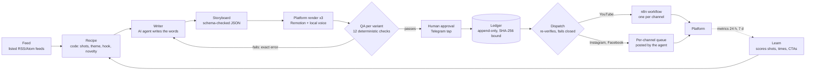

# FORGE Content Studio: open-source AI short-video automation with Remotion and TypeScript

**FORGE Content Studio** plans, writes, renders, checks and dispatches faceless short videos (YouTube Shorts, Instagram Reels, Facebook) from your own Mac. Rendering is [Remotion](https://www.remotion.dev) and TypeScript, the voice is local [Kokoro](https://github.com/hexgrad/kokoro) text-to-speech, and nothing is published until a human approves it.

[](LICENSE)
[](https://www.remotion.dev)
[](https://github.com/hexgrad/kokoro)
[](https://n8n.io)
[](https://nodejs.org)
[](https://www.typescriptlang.org/)

## Why FORGE: automated shorts that pass their own quality gates

FORGE automates idea intake, hook and script writing, motion-graphic rendering, quality checks and multi-platform dispatch, and **refuses to publish anything until a human says yes**. Deterministic code gates check the script and the storyboard before any render is spent, and an approval ledger bound to the exact video hash stands between a finished render and your audience. Setup: [docs/INSTALL.md](docs/INSTALL.md). Daily use: [docs/OPERATIONS.md](docs/OPERATIONS.md).

---

## What you can build with FORGE

| Use case | What FORGE does |
|----------|-----------------|
| **Faceless short-video production** | Platform-specific videos (25 to 60 s, by channel) for YouTube Shorts, Instagram Reels and Facebook from listed RSS/Atom feeds; one approval tap per video |
| **Script and hook quality control** | Free, deterministic script gate: hook rules, 15-word sentences, 10-word average, banned filler, a re-hook at least every 18 s, one sourced proof per video |
| **Kinetic typography and motion graphics** | Remotion shot primitives (inbox, sheet, chat, diff, flow, counter); Kokoro's exact word times drive the host format's karaoke captions, where marked power words pop to 1.2x |
| **Human-in-the-loop production** | Schema-enforced storyboards, hash-verified approvals, an append-only dispatch ledger, and no blind retries on unknown uploads |

---

## Live Demo

<table><tr>
<td width="360" valign="top">

https://github.com/user-attachments/assets/0b320102-7cf2-4a57-982e-5fe07f4671e2

</td>
<td valign="top">

**A generated sample from the pipeline**: a test storyboard rendered by the engine and passed by QA (a verification render, not a channel post).

- **Topic:** chasing unpaid invoices: payment reminders typed by hand versus a reminder flow that runs itself every morning (illustrative example data).
- **Platform:** `c1-automation`, YouTube variant ("Subscribe" CTA and end card). The same board also renders Instagram and Facebook variants with their own CTA, end card and caption.
- **Format:** 44.18 s (allowed 40 to 60 s), 1080x1920, 30 fps, local Kokoro voice.
- **Built from:** `engine/test/style-c1.json`, style `c1-night-signal-v1`, recipe `style-test-c1`; 8 shots: word-stack-slam, pile-drop, ui-chat, before-after-split, flow-run, ui-sheet, counter-drop, end-card.
- **QA:** 12 of 12 checks passed ([qa-c1.txt](docs/proof/qa-c1.txt)).
- **Why this one:** the richer of the two verified boards (7 distinct primitives against 5), so one file exercises voice measurement, text fit and the platform CTA rules.

The player is a 4.3 MB re-encode (GitHub's inline limit is 10 MB). The original is [c1-automation-youtube-2026-10-04-style-c1.mp4](docs/proof/demo/c1-automation-youtube-2026-10-04-style-c1.mp4); its SHA-256 matches [c1-youtube.json](docs/proof/manifests/c1-youtube.json).

</td>
</tr></table>

---

## How FORGE Works

FORGE runs autonomous short-video channels on YouTube, Instagram, and Facebook from your Mac. Each week it plans the videos in code, has an AI agent write the words, renders one video per platform with a React motion engine and a local voice, checks every file with deterministic QA, and sends each passing video to you on Telegram. Nothing is published until you tap Approve, and dispatch re-verifies everything right before sending.

### Automated vs. Human-Controlled

| Automated | Human-controlled |
|---|---|
| Topic intake from listed feeds, weekly planning, novelty rules | Approving each video (one Telegram tap per video, or "Approve all" for videos already shown) |
| Writing the storyboard (AI) and fixing it until QA passes | Taking an approval back before it goes out (`node studio/ledger.ts reject <id>`) |
| Rendering three platform variants, voice, captions, thumbnails | Turning a channel live, and turning dispatch live (two separate switches) |
| QA, routing, dispatch, retries, publish confirmation, metrics intake | Resolving an upload whose result is unknown (the system never retries it blind) |
| Small, logged tuning (posting times, benched shots) from metrics | Any larger change Learn proposes (applied only on a tap) |

**Live since 4 October 2026** on two channels, posting every other day ([docs/proof/live.txt](docs/proof/live.txt)). The render watcher is paused while the Director's cost guards are built.

---

## Architecture: The FORGE Pipeline



**Key principles:**
- **The Mac is the source of truth.** State is JSON and JSONL files in the repo's `state/`; n8n is a relay that holds platform credentials and asks the Mac before every upload.
- **Code decides, AI writes.** Planning, QA, approval, routing and learning are plain TypeScript. The AI agent fills in words and runs fixed posting skills.
- **One render per platform.** Each video becomes three independent files with their own call to action, end card, caption and approval line.

---

## Tech Stack: Built on Production-Grade Tools

- **Engine and renderer:** Remotion with TypeScript on Node 26 (`engine/`, render scripts `make.mjs` and `film.mjs`). No FFmpeg install is needed.
- **Primitives and composer:** deterministic Remotion shot primitives (inbox, sheet, chat, diff, flow, counter and more), a Composer that sequences them, host karaoke captions, and `Score`, which ducks each channel's synthesised music bed 10 dB under the voice and closes with a 2 s sonic bumper.
- **Voice and timing:** local Python text-to-speech with [Kokoro](https://github.com/hexgrad/kokoro) (82M parameters, no paid voice API). Its exact per-word times drive captions and word-timed cards. There is no speech-to-text step.
- **Quality gates (free, no model call):** `studio/script.ts` (hook, readability, re-hook, sourced proof), `engine/src/composer/density.ts` (no 2.5 s gap with nothing new on screen), theme contrast, text-box QA, and JSON Schema contracts checked by an in-repo validator.
- **Orchestration:** the studio is TypeScript with no build step (`studio/`); n8n runs in Docker and relays YouTube uploads, stats and feeds, asking the Mac before every upload.
- **Human approval:** signed Telegram approvals, a SHA-256-bound append-only ledger, and fail-closed dispatch.
- **State:** JSON and JSONL files in the repo. No database is required.

---

## Engineering Principles

| Principle | Enforced By |
|---|---|
| Deterministic execution | Recipes, QA, routing and learning are pure functions over files; no model call decides a state transition |
| Human-in-the-loop governance | `applyApproval` is the only code path that writes approved, only from signed links or the owner's Telegram |
| Fail-closed behaviour | Every outward step re-checks inputs immediately and refuses with a reason; unclear results are "unknown" |
| Hash-bound approval | Approval records SHA-256 of the exact video approved; re-render requires new approval |
| Platform isolation | Each (channel, platform) pair has exactly one route: YouTube → n8n, Instagram/Facebook → queue |
| Idempotent dispatch | A variant is claimed before any call; each step writes before the next; second run sends nothing |
| Append-only state | Ledger, fingerprints, and metrics are JSONL; latest line per key wins; crashed lines are ignored |
| Schema contracts | Every exchanged file has JSON Schema; in-repo validator throws on unsupported keywords |
| Independent QA | QA reads rendered files, not renderer's claims; probes MP4, measures text from real browser render |
| Reproducibility | Test boards and fixtures are in the repo; `npm run check` reproduces verification on any Mac |

---

## 60-Second Quickstart

**Requirements:** macOS 14+, Node 26, Python 3.12 with uv and espeak-ng (local voice only), Docker Desktop (n8n only; not needed to render or to run `npm run check`)

```bash
# Clone and enter
git clone https://github.com/navin-labs/forge-content-studio.git
cd forge-content-studio/engine

# Install dependencies
npm install

# Verify (types, themes, text QA, schema validation, 19 studio test suites)
npm run check

# Run a silent smoke render
npm run make -- test/demo.json

# (With voice) Reproduce QA on the production-ready test boards
export VOICE=on
npm run make -- test/style-c1.json test/style-c2.json

# Run the full-cycle simulation (Telegram & n8n are fakes; nothing is posted)
cd ..
node studio/simulate.ts
```

For production setup (channels, n8n, Telegram, the agent, launchd services): [docs/INSTALL.md](docs/INSTALL.md) → [docs/SETUP.md](docs/SETUP.md).

---

## The FORGE Pipeline: Detailed

1. **Feed** (`studio/feed.ts`): Fetches only feeds listed in `channel.json`, parses RSS/Atom, validates each idea, dedupes per channel.
2. **Recipe** (`studio/recipe.ts`, `studio/novelty.ts`): Code picks each posting day's shot list, theme, transitions and hook pattern.
3. **Writer** (AI agent, `agents/writer/FORGE_WEEKLY_WRITER.md`): Writes storyboard from top ideas, within measured text limits, passes the engine `--check` gate: the script gate (`studio/script.ts`: hook, 15-word sentences, 10-word average, banned filler, a re-hook at least every ~45 words, one sourced proof) and the visual-density gate (`engine/src/composer/density.ts`: no 2.5 s with nothing new on screen).
4. **Director** (AI agent, `agents/director/DIRECTOR.md`): Creates authored film with creative brief, Critic judges on 15 scores and 8 anti-slop tests.
5. **Render** (`engine/`): Renders each saved board once per platform with local voice measured line by line, then re-checks the re-hook and density gates on the measured clips. Channel boards also get the channel's music bed (ducked under the voice) and 2 s sonic bumper.
6. **QA** (`studio/qa.ts`): 12 checks per variant (schema, text limits, audio, format, duration, captions, fingerprint, manifest, CTA, SEO).
7. **Approval** (`studio/telegram.ts`, `studio/ledger.ts`): Each passing video reaches Telegram; tap writes ledger line with hash.
8. **Dispatch** (`studio/dispatch.ts`): Plans, re-verifies, and sends; YouTube as scheduled upload, Instagram/Facebook as queue items.
9. **Publish & Learn** (`studio/metrics.ts`, `studio/learn.ts`): Accept metrics only for dispatched posts; Learn benches weak shots and tunes posting times.

---

## Platform Variants

| Platform | CTA | Route | End Card |
|----------|-----|-------|----------|
| YouTube | Subscribe | Channel's n8n workflow, private scheduled upload | YouTube handle |
| Instagram | Follow or DM | `queue/<channel>/instagram/`, posted by agent | Instagram handle |
| Facebook | Follow | `queue/<channel>/facebook/`, posted by page ID | Page handle |

Each variant is independent: one platform's problem never holds the others.

---

## Safety Model

- **Signed approvals** — HMAC-SHA256 over channel, week, ids, approver and expiry; single-use, expiring; secret in `.env`
- **Hash verification** — QA records file hash; approval records approved hash; dispatch recomputes and refuses on any difference
- **Dispatch gates** — Valid ledger line, channel owns board, manifest matches (channel, platform, video), exactly one publisher with right route, channel live
- **Two switches** — `"live": true` in `channel.json` + `--live` + `DISPATCH_LIVE=on` both required
- **Unknown uploads** — If n8n's answer is unclear, variant stays `dispatching` and is never auto-resent
- **Defence in depth** — Each n8n workflow accepts only its channel's jobs; receiver listens on 127.0.0.1 only

---

## Verification & Status

**Verified on:** macOS on Apple silicon, Node 26.0.0, 2026-10-04

| Test | Result |
|------|--------|
| `npm run check` in `engine/` | Types, theme contrast (WCAG AA), text QA, schemas and 19 studio test suites pass (re-run 2026-10-26) |
| `node studio/qa.ts` on test boards | YouTube, Instagram, Facebook: 12/12 checks per variant |
| `node studio/simulate.ts` | Full cycle: 2 videos × 3 variants approved and routed; 10 refusal cases refused; idempotent |

### Current Status

| Area | State |
|---|---|
| Implemented & verified locally | Everything in the pipeline above |
| In production | Since 2026-10-04: C1 and C2 live, 8 n8n workflows active |
| Depends on external accounts | YouTube OAuth in n8n, Telegram bot, AI agent with Meta connector |
| Open | Facebook usernames pending, C1 CTA mix, C3 style preset |

---

## Design Trade-Offs

- **Filesystem + JSONL state, not database** — One writer process, files that n8n/agent/person can all read and diff; costs: no concurrent writers
- **Mac-first execution** — Browser rendering, local voices, launchd services; costs: single point of failure (mitigated with Google Drive backups)
- **n8n as relay, not brain** — Decisions stay in TypeScript; costs: two systems to deploy
- **Deterministic simulation** — Real renders through real QA with fake Telegram/n8n; skip live end-to-end tests in favor of fail-closed design
- **Specific, not generic** — Tailored to short-video channels; not a reusable agent framework

---

## Frequently asked questions

**Does FORGE post videos by itself?** No. A video is dispatched only after a signed approval from the owner (a Telegram tap) that is bound to that exact file's SHA-256 hash. Dispatch re-checks everything right before sending.

**Which platforms does it support?** YouTube Shorts (through an n8n upload workflow per channel), Instagram Reels and Facebook (through a per-channel queue the AI agent posts from). Each platform gets its own render, call to action, end card and caption.

**Does it need a paid voice API?** No. The voice is local, open-source Kokoro text-to-speech. Its per-word times drive the captions, so no speech-to-text step is used.

**Do I need FFmpeg, a database or a hosted model?** No FFmpeg install and no database. The code needs Node, Remotion, Python for the local voice, and Docker for n8n. An AI agent with file access writes the scripts and posts to Instagram and Facebook.

**How does it avoid repetitive videos?** Recipes pick each video's shot list, theme and hook pattern in code under seven novelty rules, and style rotation blocks repeats of look, colour suit, format, camera, hook, structure and call to action.

---

## Documentation

| Guide | Purpose |
|-------|---------|
| [docs/INSTALL.md](docs/INSTALL.md) | macOS setup: tools, voice, configuration, n8n, agent, services, verification |
| [docs/SETUP.md](docs/SETUP.md) | Channels, accounts, going live |
| [docs/OPERATIONS.md](docs/OPERATIONS.md) | Daily cycle, Telegram messages, health checks, troubleshooting |
| [docs/TECH.md](docs/TECH.md) | Technical design: variants, contracts, QA, approval, dispatch, learning, security |
| [docs/DECISIONS.md](docs/DECISIONS.md) | Architecture decision records |
| [docs/AGENTS.md](docs/AGENTS.md) & [agents/](agents/) | Each agent's job, inputs, outputs, never-do list |
| [docs/MOTION.md](docs/MOTION.md) & [engine/README.md](engine/README.md) | Motion rules, style presets, render engine, voices |
| [n8n/README.md](n8n/README.md) | n8n workflows and Mac endpoints |
| [docs/proof/](docs/proof/README.md) | Verification logs, render manifests, production snapshot |

---

## Configuration

Configuration is by variable name only; values never appear in the repo. Templates: [.env.example](.env.example) and [engine/.env.example](engine/.env.example).

---

## Repository Structure

| Path | Contents |
|---|---|
| `studio/` | Orchestrator: feed, recipe, QA, ledger, Telegram, dispatch, metrics, learn |
| `engine/` | Remotion renderer: primitives, themes, composer, text-fit, render, TTS bridge |
| `schemas/` | JSON Schemas for every exchanged file, validator, samples |
| `styles/` | Versioned style presets (YouTube, Instagram, Facebook) |
| `channels/` | One folder per channel: `channel.json` and rulebook |
| `agents/` | Writer, Director, Critic skills and their contracts |
| `n8n/` | Exported n8n workflows: YouTube, Instagram, Facebook, stats |
| `brand/` | Channel brand assets |
| `docs/` | Install, setup, operations, technical design, decisions |
| `state/`, `recipes/`, `ideas/`, `queue/` | Runtime data (git-ignored) |

---

## License

MIT, see [LICENSE](LICENSE). Third-party parts keep their own licenses: Remotion (free for individuals and small companies); fonts (SIL Open Font License); icons (Lucide, ISC). See `engine/README.md` for full licensing.

---

## Built by Navin Labs

**FORGE Content Studio** is an autonomous video orchestration engine built and maintained by **[Navin Labs](https://github.com/navin-labs)** (@navin-labs).

- 🌟 **Star this repo** if you find FORGE useful
- 🔗 **Follow [@navin-labs](https://github.com/navin-labs)** for updates
- 💬 **Questions?** Open an issue or check the [documentation](docs/)

Issues and pull requests are welcome. Every video is held to the same gates before a human sees it.
